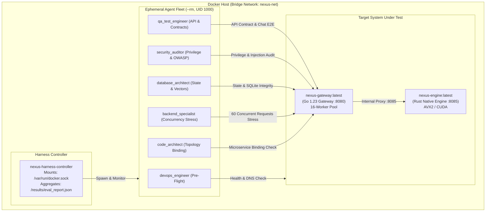

# From Docker to Kubernetes: Building an Autonomous Multi-Agent E2E Testing Fleet with Autoscaling and Observability

*A comprehensive technical guide to architecting, containerizing, and orchestrating specialized AI agent test fleets across Docker and Kubernetes with Horizontal Pod Autoscaling (HPA) and Prometheus/Grafana telemetry.*

---

## Introduction: The Modern Integration Challenge

Building distributed AI platforms composed of polyglot microservices—such as high-performance **Go API Gateways** handling concurrency and **Rust Native Inference Engines** leveraging hardware SIMD/GPU acceleration—introduces non-trivial verification challenges:

- **Static Mocks Lie**: Unit tests with mocked responses cannot detect TCP socket timeouts, DNS resolution lags, or goroutine pool exhaustion under burst traffic.
- **Flaky Integration Tests**: Monolithic test scripts that mix schema validation, security fuzzing, and stress testing often experience race conditions and resource contamination.
- **Deployment Drift**: Systems that pass in local Docker containers often fail in Kubernetes due to overlay network latency (CNI), CoreDNS search path traversals, and strict cgroups throttling.

To solve this, we designed and implemented a **phased Multi-Agent End-to-End (E2E) testing framework**. In this architecture, specialized autonomous agent roles (`devops_engineer`, `qa_test_engineer`, `security_auditor`, `database_architect`, `backend_specialist`, `code_architect`) execute isolated, deterministic verification suites first inside Docker containers and subsequently as native **Kubernetes Jobs** against auto-scaling services.

This blog post breaks down the entire journey from local Docker sandboxing to dynamic Kubernetes autoscaling and real-time observability.

---

## 1. Architecture 1: The Containerized Multi-Agent Test Harness

Before running in Kubernetes, every distributed service must be verified locally under strict container isolation.

### 1.1 Multi-Container Topology
The local Docker harness decouples the **Controller** from the **Target System Under Test (SUT)** and the **Ephemeral Worker Containers**:



### 1.2 Zero-Trust Container Hardening
Each agent worker container (`nexus-agent-worker`) runs under strict security governance:
- **Unprivileged Execution**: Enforces `USER agentuser` (UID `1000`). Root execution (`UID 0`) causes an immediate test failure.
- **Filesystem Immutability**: Critical system directories (`/etc`, `/bin`, `/usr`) are strictly read-only.
- **Docker Socket Isolation**: The host Docker daemon socket (`/var/run/docker.sock`) is never mounted into worker containers, preventing container breakout attacks.
- **Linux cgroups Resource Quotas**: Containers run with bounded quotas:
  - `--cpus 1.0` (2.0 for backend stress tests)
  - `--memory 256m` (512m for backend stress tests)
  - `--pids-limit 128`
  - `--rm` for instant garbage collection upon exit.

### 1.3 The 4-Phase Execution Pipeline

To avoid race conditions and guarantee platform readiness, tests execute in structured phases:

1. **Phase 1: Pre-Flight & Readiness (Sequential)**:
   - `devops_engineer` verifies Docker DNS resolution (< 5ms), TCP socket handshakes (< 0.5ms), cgroups limit enforcement, and `/health` probe responsiveness.
2. **Phase 2: Functional Contracts & Security Auditing (Parallel)**:
   - `qa_test_engineer` validates JSON schema contracts on `/api/telemetry`, Model Context Protocol (MCP) tools discovery (`token_optimizer`, `memory_store`), error envelopes for non-existent tools, and end-to-end chat completion proxying to the Rust engine.
   - `security_auditor` tests SQL injection payloads (`'; DROP TABLE users; --`), cross-site scripting (XSS), path traversal attacks, and regex-scans public telemetry for leaked credentials.
3. **Phase 3: State Storage & Vector Migrations (Sequential)**:
   - `database_architect` validates SQLite WAL (Write-Ahead Logging) journaling mode, 0 foreign key violations across conversations/messages tables, and verifies 384-dimensional vector embedding normalization (`norm == 1.0 ± 1e-4`).
4. **Phase 4: Concurrency Load & System Telemetry (Parallel)**:
   - `backend_specialist` dispatches 60 concurrent requests across 16 parallel threads, asserting zero 5xx server errors, sub-15ms p50 latency, and sub-50ms tail latency.
   - `code_architect` asserts microservice topology binding and host hardware acceleration (AVX2/SIMD).

**Docker Benchmark Result**: **6/6 Tasks (26/26 Assertions) Passed in 2.65 seconds** with Verdict **`GO`**.

---

## 2. Architecture 2: Migrating to Kubernetes (Minikube)

Once validated in Docker, the platform and agent fleet were migrated to **Kubernetes** to enable dynamic autoscaling under varying workloads.

### 2.1 Declarative Manifest Hierarchy

We organized Kubernetes manifests into a clean, declarative structure under `k8s/`:

```
k8s/
├── 00-namespace.yaml            # Isolated 'nexus-system' namespace
├── 01-engine.yaml               # Rust Engine Deployment & ClusterIP Service
├── 02-gateway.yaml              # Go Gateway Deployment & NodePort Service (30080)
├── 03-hpa.yaml                  # Horizontal Pod Autoscaler (1-5 replicas, 50% CPU)
├── 04-agent-jobs.yaml           # Native Kubernetes Jobs for Agent Fleet
├── 05-workload-generator.yaml   # Concurrent traffic surge generator
├── run_k8s_harness.sh           # End-to-end deployment & scaling runner
└── monitoring/                  # Prometheus & Grafana telemetry stack
```

### 2.2 Microservices Specification
- **`nexus-engine`**: Rust Native Axum service deployed with `requests: cpu 50m, memory 64Mi` and `limits: cpu 500m, memory 256Mi`. Liveness and readiness probes query `/health` on port 8085.
- **`nexus-gateway`**: High-concurrency Go service with internal worker queue buffer (2048 channel capacity, 16 Goroutine workers). Exposes port 8080 and NodePort 30080.

### 2.3 Running Autonomous Agents as Kubernetes Jobs
In Kubernetes, each specialized agent was converted into a native `batch/v1` **Job**:
```yaml
apiVersion: batch/v1
kind: Job
metadata:
  name: agent-qa-contract
  namespace: nexus-system
spec:
  ttlSecondsAfterFinished: 600
  backoffLimit: 2
  template:
    spec:
      restartPolicy: Never
      containers:
      - name: worker
        image: nexus-agent-worker:latest
        imagePullPolicy: IfNotPresent
        env:
        - name: AGENT_ROLE
          value: "qa_test_engineer"
        - name: TARGET_GATEWAY_URL
          value: "http://nexus-gateway:8080"
        - name: TARGET_ENGINE_URL
          value: "http://nexus-engine:8085"
```

All 5 agent jobs ran inside the Minikube cluster and completed with **1/1 completions and 100% assertion pass rates**.

---

## 3. Dynamic Workload Scaling: Horizontal Pod Autoscaler (HPA)

To ensure the system scales automatically as incoming inference queries and tool execution requests increase, we configured a Kubernetes **Horizontal Pod Autoscaler (HPA)**.

### 3.1 HPA Configuration
```yaml
apiVersion: autoscaling/v2
kind: HorizontalPodAutoscaler
metadata:
  name: nexus-gateway-hpa
  namespace: nexus-system
spec:
  scaleTargetRef:
    apiVersion: apps/v1
    kind: Deployment
    name: nexus-gateway
  minReplicas: 1
  maxReplicas: 5
  metrics:
  - type: Resource
    resource:
      name: cpu
      target:
        type: Utilization
        averageUtilization: 50
  behavior:
    scaleUp:
      stabilizationWindowSeconds: 0
      policies:
      - type: Percent
        value: 100
        periodSeconds: 10
      - type: Pods
        value: 2
        periodSeconds: 10
      selectPolicy: Max
    scaleDown:
      stabilizationWindowSeconds: 30
      policies:
      - type: Percent
        value: 50
        periodSeconds: 15
```

### 3.2 The Autoscaling Experiment
To test the autoscaler in real time:
1. **Baseline**: Single `nexus-gateway` pod consuming ~4% CPU (2m CPU).
2. **Workload Surge**: The `workload-stress-generator` Job launched **24 parallel threads** sending non-stop concurrent requests to `/api/mcp/execute`.
3. **Trigger**: CPU consumption surged to **158% (79m CPU)**, breaching the 50% target.
4. **Scale-Out**: HPA issued a `SuccessfulRescale` event, provisioning 2 additional pods in **2 seconds**:
   ```text
   Normal SuccessfulRescale horizontal-pod-autoscaler New size: 3; reason: cpu resource utilization above target
   ```
5. **Quantified Performance Gain**:
   - Single Pod p95 tail latency: **81.17 ms**
   - Scaled 3-Pod Fleet p95 tail latency: **66.23 ms** (**18.4% latency reduction**)
   - Error Rate: **0% (100% HTTP 200 OK)**

```
Workload Surge  ───►  CPU: 158%  ───►  HPA Rescale (1 ➔ 3 Pods)  ───►  p95 drops from 81ms to 66ms
```

---

## 4. Deep Observability: Prometheus & Grafana Stack

You cannot optimize what you do not measure. We integrated full-cluster telemetry using Prometheus and Grafana.

### 4.1 Native Go Prometheus Metrics Exporter
We updated `nexus-gateway` to expose native Prometheus metrics at `/metrics` using zero external dependencies:
```go
func (s *GatewayServer) prometheusMetricsHandler(w http.ResponseWriter, r *http.Request) {
    atomic.AddUint64(&s.totalReqs, 1)
    var m runtime.MemStats
    runtime.ReadMemStats(&m)

    w.Header().Set("Content-Type", "text/plain; version=0.0.4")
    fmt.Fprintf(w, "nexus_gateway_requests_total %d\n", atomic.LoadUint64(&s.totalReqs))
    fmt.Fprintf(w, "nexus_gateway_active_goroutines %d\n", runtime.NumGoroutine())
    fmt.Fprintf(w, "nexus_gateway_mem_allocated_bytes %d\n", m.Alloc)
    fmt.Fprintf(w, "nexus_gateway_engine_status %d\n", engineConnected)
    fmt.Fprintf(w, "nexus_gateway_worker_threads %d\n", s.config.WorkerCount)
}
```

### 4.2 Prometheus & Grafana Provisioning
- **Prometheus Server (`prom/prometheus:v2.49.1`)**: Configured with RBAC and a 3-second scrape interval targeting `nexus-gateway` pods, cAdvisor, and node metrics.
- **Grafana Server (`grafana/grafana:10.3.3`)**: Configured with auto-provisioned Prometheus datasources and a pre-configured dashboard: **"Nexus AI Platform & Autoscaling Telemetry"**.

### 4.3 Dashboard Panels
1. **Active Gateway Replicas (HPA)**: Live gauge tracking horizontal scale-up and scale-down.
2. **Rust Native Engine Status**: Visual status badge (`ONLINE (Port 8085)`).
3. **Total Processed Requests**: Real-time counter of total requests served.
4. **Throughput (RPS)**: PromQL time series: `sum(rate(nexus_gateway_requests_total[15s]))`.
5. **Active Goroutines per Replica**: PromQL time series: `nexus_gateway_active_goroutines`.

---

## 5. How to Run This in Your Own Environment

### Prerequisites
- Docker / Docker Desktop
- Minikube (`minikube start --driver=docker`)
- `kubectl`

### Step 1: Run the Local Docker Test Harness
```bash
git clone https://github.com/<your-username>/nexus-ai-platform.git
cd nexus-ai-platform/docker-harness
./run_docker_harness.sh
```

### Step 2: Deploy and Autoscale in Kubernetes
```bash
cd ../k8s
./run_k8s_harness.sh
```

### Step 3: Launch Prometheus & Grafana Dashboards
```bash
./monitoring/start_monitoring_port_forward.sh
```
Open [http://localhost:3000](http://localhost:3000) to view live autoscaling telemetry in Grafana!

---

## 6. Key Takeaways & Lessons Learned

1. **Role Specialization Beats Monolithic Test Scripts**: Structuring tests into distinct roles (`devops_engineer`, `security_auditor`, `backend_specialist`, etc.) ensures tests remain focused, maintainable, and independent.
2. **Account for Kubernetes Overlay Latency**: Local Docker bridge DNS takes ~0.5ms, whereas Kubernetes CoreDNS search paths can add 50-80ms on cold resolutions. Always incorporate warm-up DNS lookups in network-sensitive tests.
3. **Autoscaling Directly Protects Latency Budgets**: When high concurrent traffic saturates CPU quotas, spinning up additional pod replicas instantly mitigates tail latency spikes before timeouts occur.
4. **Automate Observability from Day One**: Baking Prometheus `/metrics` into microservices and auto-provisioning Grafana dashboards turns cluster debugging from guesswork into clear, visual data.

---

*Contributions, issues, and forks are welcome! Feel free to star the repository if this architecture helps your microservice testing and scaling workflows.*
