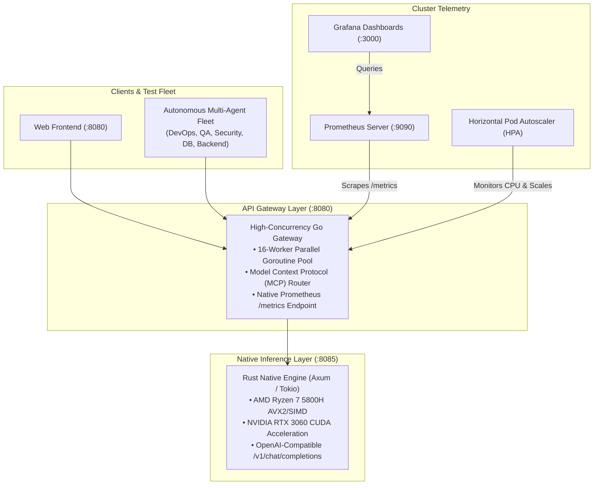

# Nexus AI Platform

A high-performance, distributed AI microservices platform featuring a **Go API Gateway**, a **Rust Native Inference Engine**, an autonomous **Multi-Agent E2E Testing Fleet on Docker**, dynamic **Kubernetes Autoscaling (HPA)**, and integrated **Prometheus & Grafana Observability**.

📖 **Read the in-depth technical guide**: [From Docker to Kubernetes: Building an Autonomous Multi-Agent E2E Testing Fleet (BLOG.md)](./BLOG.md)

---

## Architecture Overview



---

## Repository Structure

```
nexus-ai-platform/
├── BLOG.md                      # Detailed technical guide and architecture deep-dive
├── docker-compose.yml           # Local multi-container development composition
├── Makefile                     # Build & control automation tasks
├── gateway-go/                  # High-concurrency Go API Gateway (port 8080)
│   ├── main.go                  # Microservice server, MCP tools, and /metrics exporter
│   ├── Dockerfile               # Multi-stage production container build
│   └── frontend-web/            # Static dashboard UI
├── engine-rust/                 # Rust Native Inference Engine (port 8085)
│   ├── src/main.rs              # Axum inference server with AVX2 & CUDA telemetry
│   └── Dockerfile               # Lean native container build
├── docker-harness/              # Phased Multi-Agent Docker Test Harness
│   ├── controller/              # Harness controller orchestrator (controller.py)
│   ├── agent/                   # Ephemeral agent worker runner (runner.py)
│   ├── benchmarks/              # Benchmark suite definitions (suite.json)
│   ├── results/                 # Evaluation reports & audit JSON
│   └── run_docker_harness.sh    # One-click Docker E2E test runner
└── k8s/                         # Kubernetes Manifests & Autoscaling
    ├── 00-namespace.yaml        # Isolated 'nexus-system' namespace
    ├── 01-engine.yaml           # Rust Engine Deployment & ClusterIP Service
    ├── 02-gateway.yaml          # Go Gateway Deployment & NodePort Service (30080)
    ├── 03-hpa.yaml              # Horizontal Pod Autoscaler (1-5 pods, 50% CPU target)
    ├── 04-agent-jobs.yaml       # Multi-agent test fleet as native Kubernetes Jobs
    ├── 05-workload-generator.yaml # High-concurrency traffic stress generator
    ├── run_k8s_harness.sh       # One-click Kubernetes deployment & autoscaling runner
    └── monitoring/              # Prometheus & Grafana telemetry stack
        ├── 00-monitoring-namespace.yaml
        ├── 01-prometheus-rbac.yaml
        ├── 02-prometheus.yaml   # Prometheus Deployment & Service (NodePort 30090)
        ├── 03-grafana.yaml      # Grafana with auto-provisioned dashboards (NodePort 30030)
        └── start_monitoring_port_forward.sh # Localhost browser port-forwarder
```

---

## Quickstart

### 1. Local Docker Multi-Agent E2E Test Suite
Run the 4-phase test suite across isolated worker containers on `nexus-net`:
```bash
cd docker-harness
./run_docker_harness.sh
```

### 2. Deploy and Autoscale in Kubernetes (Minikube)
Ensure Minikube is active (`minikube start --driver=docker`), then execute:
```bash
cd k8s
./run_k8s_harness.sh
```
This script deploys the microservices, executes all multi-agent test Jobs, and simulates a traffic burst demonstrating real-time HPA pod scaling from 1 to 3 replicas.

### 3. Launch Live Telemetry & Grafana Dashboards
```bash
cd k8s/monitoring
./start_monitoring_port_forward.sh
```
Open your browser to:
- **Grafana Dashboard**: [http://localhost:3000](http://localhost:3000)
- **Prometheus UI**: [http://localhost:9090](http://localhost:9090)

---

## License
MIT License
