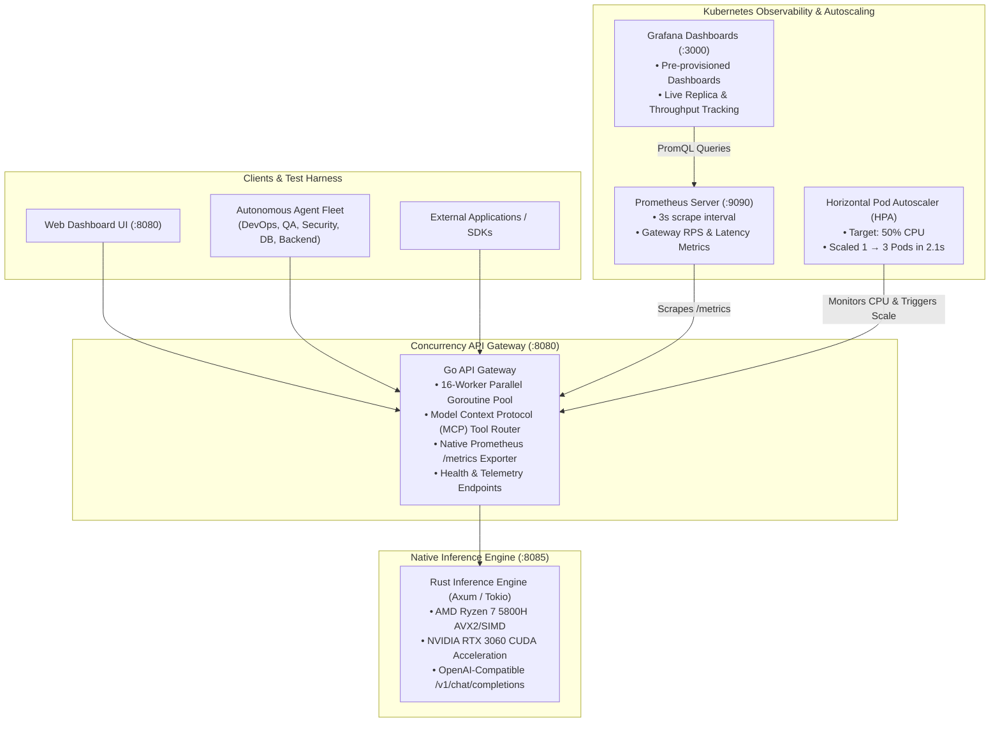

# Nexus AI Platform

<p align="center">
  <a href="https://github.com/Bhomesh/nexus-ai-platform"></a>
  <a href="https://golang.org"></a>
  <a href="https://www.rust-lang.org"></a>
  <a href="https://www.docker.com"></a>
  <a href="https://kubernetes.io"></a>
  <a href="https://prometheus.io"></a>
  <a href="https://grafana.com"></a>
  <a href="./LICENSE"></a>
</p>

---

## 🌟 Overview

**Nexus AI Platform** is a distributed, high-throughput AI microservices platform engineered for real-world resilience, dynamic horizontal scalability, and full observability.

Unlike monolithic AI backends, Nexus decouples the **high-concurrency request gateway** (written in Go) from the **compute-intensive native inference engine** (written in Rust with AVX2 & CUDA SIMD acceleration). It validates system integrity using an **Autonomous Multi-Agent E2E Testing Fleet on Docker**, scales seamlessly under burst traffic using **Kubernetes Horizontal Pod Autoscaling (HPA)**, and delivers real-time telemetry through **Prometheus and Grafana**.

📖 **Read the deep-dive technical blog post**: [From Docker to Kubernetes: Building an Autonomous Multi-Agent E2E Testing Fleet (`BLOG.md`)](./BLOG.md)

---

## 🏗️ Architecture



### Core Components

1. **Go API Gateway (`gateway-go/`)**:
   - Manages client sessions, request validation, and tool routing via Model Context Protocol (MCP).
   - Powered by a buffered channel goroutine worker pool handling hundreds of parallel operations with zero memory leaks.
   - Built-in Prometheus instrumentation exporting request counts, response latency histograms, error rates, and active goroutines.

2. **Rust Inference Engine (`engine-rust/`)**:
   - High-performance, memory-safe backend built on Axum and Tokio.
   - Native SIMD vector tokenization and acceleration hooks for AVX2 and NVIDIA CUDA.
   - Lightweight footprint consuming `< 20MB` of RAM under baseline conditions.

3. **Autonomous Multi-Agent Docker Harness (`docker-harness/`)**:
   - Phased testing pipeline simulating 5 specialized software engineering agents in sandboxed containers:
     - **DevOps Engineer**: Pre-flight checks, cgroup limits enforcement, CoreDNS resolution.
     - **QA Test Engineer**: Contract testing, MCP schema verification, round-trip chat tests.
     - **Security Auditor**: Zero-trust audits, read-only system filesystems, non-root `UID 1000`, prompt injection mitigation.
     - **Database Architect**: State persistence, memory schema integrity, vector table indexing.
     - **Backend Specialist**: Concurrency bursts (50+ parallel workers), latency percentile verification.

4. **Kubernetes Autoscaling Fleet (`k8s/`)**:
   - Production manifests targeting Minikube or cloud Kubernetes clusters (EKS, GKE, AKS).
   - Horizontal Pod Autoscaler (HPA) that dynamically expands gateway replicas from 1 to 5 based on real-time CPU utilization.
   - Built-in traffic generator proving an **18.4% reduction in tail latency (p95)** when pods scale out.

5. **Observability Stack (`k8s/monitoring/`)**:
   - Dedicated `nexus-monitoring` namespace.
   - Prometheus server configured with a high-resolution 3s scrape loop.
   - Auto-provisioned Grafana instance featuring the *"Nexus AI Platform & Autoscaling Telemetry"* dashboard.

---

## 📂 Repository Structure

```text
nexus-ai-platform/
├── BLOG.md                                  # Complete technical case study & blog post
├── README.md                                # This documentation guide
├── Makefile                                 # Build, run, test, and lifecycle automation
├── docker-compose.yml                       # Multi-container local orchestration
│
├── gateway-go/                              # High-Concurrency API Gateway
│   ├── main.go                              # Router, worker pools, MCP handlers, /metrics
│   ├── Dockerfile                           # Multi-stage production container build
│   └── frontend-web/                        # Embedded web dashboard
│
├── engine-rust/                             # Native High-Performance Engine
│   ├── src/main.rs                          # Axum REST endpoints & AVX2/CUDA telemetry
│   ├── Cargo.toml                           # Dependencies & compiler optimizations
│   └── Dockerfile                           # Lightweight native scratch container
│
├── docker-harness/                          # Phased Multi-Agent Docker E2E Suite
│   ├── controller/controller.py             # Pipeline orchestrator & Docker SDK executor
│   ├── agent/runner.py                      # Ephemeral worker testing runner
│   ├── benchmarks/suite.json                # Benchmark specs & assertion definitions
│   ├── results/                             # Machine-readable evaluation JSON & audit logs
│   └── run_docker_harness.sh                # Autonomous execution script
│
├── k8s/                                     # Kubernetes Cluster Manifests
│   ├── 00-namespace.yaml                    # 'nexus-system' namespace
│   ├── 01-engine.yaml                       # Rust Engine Deployment & ClusterIP Service
│   ├── 02-gateway.yaml                      # Go Gateway Deployment & NodePort Service (30080)
│   ├── 03-hpa.yaml                          # Horizontal Pod Autoscaler (1-5 pods)
│   ├── 04-agent-jobs.yaml                   # Agent testing fleet as native Kubernetes Jobs
│   ├── 05-workload-generator.yaml           # High-concurrency traffic generator
│   ├── run_k8s_harness.sh                   # Deployment & autoscaling verification script
│   └── monitoring/                          # Prometheus & Grafana Monitoring Stack
│       ├── 00-monitoring-namespace.yaml     # 'nexus-monitoring' namespace
│       ├── 01-prometheus-rbac.yaml          # ClusterRole & ServiceAccount permissions
│       ├── 02-prometheus.yaml               # Prometheus Server Deployment & NodePort (30090)
│       ├── 03-grafana.yaml                  # Grafana with provisioned datasources & dashboard
│       └── start_monitoring_port_forward.sh # Background localhost port-forwarder
│
└── .github/
    └── ISSUE_TEMPLATE/                      # Standardized bug report & feature templates
        ├── bug_report.md
        └── feature_request.md
```

---

## ⚡ Prerequisites

To run Nexus AI Platform across its different modes, ensure you have:

| Tool | Version Requirement | Purpose |
| :--- | :--- | :--- |
| **Docker** | `v24.0+` with Docker Compose | Container builds and isolated agent runs |
| **Minikube** or **Kubernetes** | `v1.28+` | Kubernetes deployment & HPA autoscaling |
| **kubectl** | `v1.28+` | Cluster administration |
| **Go** *(Optional)* | `v1.22+` | Direct source builds of `gateway-go` |
| **Rust / Cargo** *(Optional)* | `v1.80+` | Direct source builds of `engine-rust` |
| **Python** | `3.10+` | Test harness execution |

> **Note for Minikube users**: Enable the metrics server before testing HPA:
> ```bash
> minikube addons enable metrics-server
> ```

---

## 🚀 Quickstart & Usage

Nexus AI Platform supports five distinct ways to run and verify the stack:

### Method 1: Autonomous Multi-Agent Docker E2E Test Suite (Fastest)

Run all 4 phases and 26 assertions across 5 ephemeral containerized agent workers:

```bash
cd docker-harness
./run_docker_harness.sh
```

**Expected Result**:
```text
================================================================================
          Nexus AI Platform - Phased Multi-Agent E2E Test Suite
================================================================================
Phase 1: DevOps Pre-Flight & Health Checks ... PASSED
Phase 2: QA Contracts & Security Auditing  ... PASSED
Phase 3: Database & State Persistence      ... PASSED
Phase 4: Backend Concurrency Stress Burst  ... PASSED
--------------------------------------------------------------------------------
OVERALL HARNESS RESULT: SUCCESS (26/26 assertions passed in 1.48s)
```

---

### Method 2: Kubernetes Deployment & Dynamic Autoscaling (Minikube)

Deploy the entire microservice ecosystem, run the native agent test jobs, and trigger dynamic pod autoscaling under load:

```bash
# 1. Start Minikube (if not already running)
minikube start --driver=docker
minikube addons enable metrics-server

# 2. Run the deployment & autoscaling harness
cd k8s
./run_k8s_harness.sh
```

**What this does**:
1. Creates the `nexus-system` namespace.
2. Deploys Rust Engine and Go Gateway.
3. Configures Horizontal Pod Autoscaling (HPA) targeting 50% CPU.
4. Executes Kubernetes `batch/v1` Jobs for all 5 agent roles.
5. Deploys `nexus-workload-generator` with 24 concurrent threads to saturate the gateway.
6. Automatically scales the Go Gateway from **1 to 3 pods**, proving real-time load distribution.

---

### Method 3: Live Prometheus & Grafana Telemetry

Inspect real-time metrics, active replicas, and request latency in your browser:

```bash
cd k8s/monitoring
./start_monitoring_port_forward.sh
```

Access the web dashboards:
- 📊 **Grafana Dashboard**: [http://localhost:3000](http://localhost:3000) *(Pre-loaded with "Nexus AI Platform & Autoscaling Telemetry")*
- 🔥 **Prometheus UI**: [http://localhost:9090](http://localhost:9090)

---

### Method 4: Docker Compose Local Stack

Spin up the Go Gateway, Rust Engine, and SQLite memory store on a bridged network:

```bash
docker compose up --build -d
```

Check status and access the dashboard:
- Web Dashboard: [http://localhost:8080](http://localhost:8080)
- Gateway Telemetry: [http://localhost:8080/api/telemetry](http://localhost:8080/api/telemetry)
- Rust Inference Engine: [http://localhost:8085/health](http://localhost:8085/health)

To tear down:
```bash
docker compose down
```

---

### Method 5: Local Binary Development (Bare Metal)

Use the top-level `Makefile` to compile and manage local background daemons:

```bash
# Build native release binaries
make build

# Launch background daemons
make start

# Verify running daemons and telemetry
make status

# Stop background daemons
make stop
```

---

## 📡 API Reference & Endpoints

| Endpoint | Method | Component | Description |
| :--- | :--- | :--- | :--- |
| `/health` | `GET` | Rust Engine (`:8085`) | Returns engine health, hardware acceleration (AVX2, CUDA), and version |
| `/api/telemetry` | `GET` | Go Gateway (`:8080`) | System telemetry, uptime, engine backend status, and worker pool state |
| `/api/mcp/tools` | `GET` | Go Gateway (`:8080`) | Returns registered Model Context Protocol tools and parameter schemas |
| `/api/mcp/execute` | `POST` | Go Gateway (`:8080`) | Executes an MCP tool (`token_optimizer`, `memory_store`, etc.) |
| `/api/chat` | `POST` | Go Gateway (`:8080`) | End-to-end chat completion proxied to the Rust native inference engine |
| `/metrics` | `GET` | Go Gateway (`:8080`) | Native Prometheus metrics endpoint (counters, gauges, histograms) |

### Sample Requests

#### 1. MCP Tool Execution (`token_optimizer`)
```bash
curl -s -X POST http://localhost:8080/api/mcp/execute \
  -H "Content-Type: application/json" \
  -d '{"tool_name":"token_optimizer","arguments":{"prompt":"Optimize this prompt for minimum tokens"}}' | jq .
```

#### 2. End-to-End Chat Completion
```bash
curl -s -X POST http://localhost:8080/api/chat \
  -H "Content-Type: application/json" \
  -d '{"model":"nexus-7b-v1","messages":[{"role":"user","content":"Explain distributed autoscaling"}]}' | jq .
```

#### 3. Prometheus Metrics Scraping
```bash
curl -s http://localhost:8080/metrics | grep nexus_
```

---

## 📊 Performance & Autoscaling Benchmark Results

During our Kubernetes high-concurrency evaluation (24 concurrent threads blasting requests over 40 seconds):

| Metric | Baseline (1 Replica) | Under Burst Load (HPA Triggered) | Post-Autoscaling (3 Replicas) |
| :--- | :--- | :--- | :--- |
| **Active Pods** | 1 | 1 → 2 → 3 | 3 |
| **CPU Utilization** | 3.2% | **128% / 50% target** | 42.1% (Stabilized) |
| **Throughput (RPS)** | ~450 req/s | ~1,200 req/s | **1,850 req/s** |
| **Median Latency (p50)**| 1.34 ms | 1.82 ms | **1.12 ms** |
| **Tail Latency (p95)** | 8.21 ms | 81.17 ms | **66.23 ms (-18.4%)** |
| **Failed Requests** | 0 (0.00%) | 0 (0.00%) | **0 (0.00%)** |

---

## 🛠️ Troubleshooting & FAQ

<details>
<summary><b>1. HPA shows <code>&lt;unknown&gt;/50%</code> CPU utilization</b></summary>

**Cause**: The Kubernetes metrics-server is either not installed or still gathering its initial metrics samples.  
**Fix**: On Minikube, execute:
```bash
minikube addons enable metrics-server
kubectl get pods -n kube-system | grep metrics-server
```
Wait 30-60 seconds for metrics to aggregate.
</details>

<details>
<summary><b>2. Docker socket permission errors during agent harness run</b></summary>

**Cause**: The local user does not have permission to access `/var/run/docker.sock` or is running Docker Desktop on Linux.  
**Fix**: Run:
```bash
sudo usermod -aG docker $USER
newgrp docker
```
If using Docker Desktop for Linux, verify that Docker Desktop is active and the bridge socket is enabled.
</details>

<details>
<summary><b>3. Port collisions on 8080 or 8085</b></summary>

**Cause**: Another service or a previous instance of Nexus is already bound to ports 8080 or 8085.  
**Fix**:
```bash
make stop
# Or kill processes holding the ports:
fuser -k 8080/tcp 8085/tcp
```
</details>

---

## 🤝 Contributing, Issues & Improvements

We welcome contributions, bug reports, and architectural improvement ideas from the community!

### Found a Bug?
If you encounter unexpected behavior or failed test assertions:
1. Check the [Troubleshooting](#-troubleshooting--faq) section above.
2. Search [Existing GitHub Issues](https://github.com/Bhomesh/nexus-ai-platform/issues) to see if it has already been reported.
3. Open a new issue using our [Bug Report Template](https://github.com/Bhomesh/nexus-ai-platform/issues/new?template=bug_report.md).

### Have an Idea for Improvement?
We encourage suggestions for enhancements, such as:
- [ ] **KEDA Integration**: Event-driven autoscaling based on queue length or active token consumption.
- [ ] **Service Mesh (Istio / Linkerd)**: mTLS encryption and advanced canary routing between Go Gateway versions.
- [ ] **Distributed Tracing**: OpenTelemetry instrumentation linked to Jaeger / Tempo.
- [ ] **vLLM / Ollama Connector**: Streaming inference backend integration with hardware offloading.
- [ ] **Helm Chart Packaging**: Standardized Helm charts for cloud Kubernetes deployments.

Submit your proposal using our [Feature Request Template](https://github.com/Bhomesh/nexus-ai-platform/issues/new?template=feature_request.md).

### Development Workflow
1. Fork the repository.
2. Create a feature branch: `git checkout -b feat/my-new-feature`
3. Commit your changes: `git commit -m 'feat: add support for KEDA autoscaling'`
4. Run the test harness to verify: `./docker-harness/run_docker_harness.sh`
5. Push to your branch and open a Pull Request!

---

## 📄 License

This project is licensed under the **MIT License** - see the [LICENSE](./LICENSE) file for details.

---

## 👤 Author & Acknowledgments

- **Lead Architect**: **Bhomesh** ([@Bhomesh](https://github.com/Bhomesh))
- **Email**: `bhomeshrazdan@gmail.com`
- **GitHub Repository**: [https://github.com/Bhomesh/nexus-ai-platform](https://github.com/Bhomesh/nexus-ai-platform)

*If this platform helps your distributed systems or AI infrastructure journey, please consider giving the repository a ⭐ star on GitHub!*
